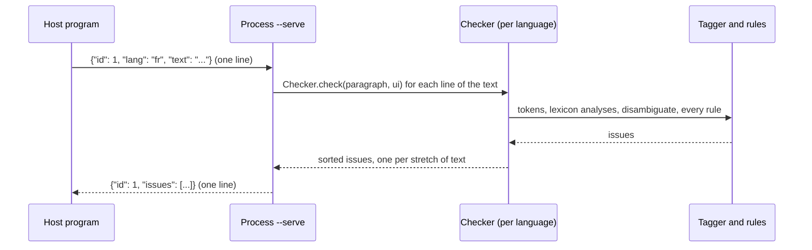

# Grammar engine API reference

*Version française : [API.fr.md](API.fr.md).*

This is the reference for anyone who writes a client or a host program. It lists every way to call the engine (Python, command line, server mode, bridge), grouped by what it is for, with its fields, what it does, its error cases and a real example. How the engine works inside is in [ARCHITECTURE.md](ARCHITECTURE.md); how to write a language is in [WRITING_A_LANGUAGE.md](WRITING_A_LANGUAGE.md); the rules are listed in [RULES.md](RULES.md); the lexicon format is in [LEXICON.md](LEXICON.md); complete programs in six languages are in [../examples/](../examples/README.md).

Covered here: checking a text, the result, languages and variants, rules, the spelling dictionary of the host, writing a language, the bridge for programs which embed Python, versions and limits. Every example below was produced by running the engine (`tools/build_api_docs.py` writes this file from a template and runs each example); engine version 0.2.0.

## 0. Conventions

### The sample sentences

Every example uses the same few sentences, so that results can be compared from one section to the next.

| Name | Language | Text | What is wrong |
|---|---|---|---|
| `FR` | `fr` | `Les chat dorment sur le canapé.` | "chat" after "les": the plural is "chats" |
| `EN` | `en` | `These book is very old.` | "book" after "these": the plural is "books" |
| `ES` | `es` | `Los casa son bonitas.` | "casa" after "los": the plural is "casas" |
| `TWO_LINES` | `fr` | `Il mange.` and `Les chat dorment.` (two paragraphs) | the second one is `FR` without its end |

### The four layers

| Layer | What it is | How it is used |
|---|---|---|
| Python API | the package `grammar_engine`: `Checker`, `Issue`, `Grammar`, `Paragraph`, `Token` | `import grammar_engine` (section 1) |
| Command line | `python -m grammar_engine` | text on the standard input or in files, JSON on the standard output (section 1) |
| Server mode | `python -m grammar_engine --serve` | one JSON request per line in, one JSON answer per line out (sections 1 to 5) |
| Bridge | the module `grammar_engine.bridge` | for a program which embeds Python and calls functions with text arguments (section 8) |

A host written in C, C++, C#, Java, JavaScript or any other language uses server mode (or the bridge, if it embeds Python). A Python program imports the package.

### Encodings

- Text is Unicode. In server mode and on the command line, JSON in UTF-8 on every pipe, whatever the code page of the machine.
- Field names are in `snake_case`. A request field which is not used is left out.
- Positions: `start` and `end` count Unicode **code points**; `byte_start` and `byte_end` count **UTF-8 bytes**. Both are zero-based and the end is excluded: the problem is `text[start:end]`. Use the pair your text widget counts in (section 3).
- Language codes: `fr`, `en`, `es`; a variant with a region: `es-AR` (or `es_AR`). Only the language and an optional variant are used, the case does not matter; `fr-FR` is looked up as `fr_fr` and, when there is no such variant, as `fr`.
- Rule identifiers: `<language>.<name>` in lower case, for example `fr.det_number`; the rules of any language start with `any.`.
- The language of the messages (`ui`): the first two letters, `en`, `fr`, `es`. Any other value gives English.

### Requests and answers (server mode)

A request is one JSON object on one line. The answer is one JSON object on one line, with the same `id`. The `id` is yours (a number or a string; it may be left out and then comes back as `null`). Answers come back in the order of the requests, one at a time.

An answer never has both `issues` and `error`. A request the engine cannot handle is answered by an `error` text meant for people; the process stays alive:

```text
> {"id": 10, "lang": "fr"}
< {"id": 10, "error": "a \"check\" request has \"text\" or \"paragraphs\""}
> {"id": 11, "op": "spell"}
< {"id": 11, "error": "unknown operation \"spell\""}
> {"id": 12, "lang": "fr", "paragraphs": "Il mange."}
< {"id": 12, "error": "\"paragraphs\" is a list of strings"}
> not json
< {"id": null, "error": "invalid request: Expecting value: line 1 column 1 (char 0)"}
> [1, 2]
< {"id": null, "error": "invalid request: a request is a JSON object"}
```

When the line is not valid JSON, or is JSON but not an object, the `id` of the answer is `null`.

### Where a paragraph ends

The engine checks **one paragraph at a time**. A line break inside a paragraph is not understood (it is read as a punctuation mark, so the rules which look at the start of a sentence or at neighbours get it wrong). Give a text as a list of paragraphs (`paragraphs`), or let the engine split on `\n` (`text` in server mode and the command line). A text of only spaces and tabs gives no issue.

## 1. Getting started

### From Python

```
import grammar_engine
```

The folder `grammar-engine` (the one which contains `grammar_engine/`) must be on `sys.path`: run from it, install it, or add it with `sys.path.insert`. There is nothing to install: the standard library is enough.

```python
import grammar_engine

checker = grammar_engine.Checker('fr')
for issue in checker.check('Les chat dorment sur le canapé.', ui='en'):
    print(issue.rule, issue.start, issue.end, issue.suggestions)

# output:
# fr.det_number 4 8 ['chats']
```

`Checker('fr')` builds the checker of a language. The first one of a language reads the lexicon (a few dozen milliseconds, section 10); the next ones share it. Keep the `Checker` and call `check()` many times.

### From the command line

`python -m grammar_engine [files] [options]` reads the files (or the standard input), one paragraph per line, and writes the issues as JSON:

```text
echo "Les chat dorment sur le canapé." | python -m grammar_engine --lang fr --ui en
[
 {
  "rule": "fr.det_number",
  "category": "agreement",
  "start": 4,
  "end": 8,
  "arg": "chats",
  "suggestions": [
   "chats"
  ],
  "confidence": 0.8,
  "message": "The determiner and the noun do not agree in number: \"chats\".",
  "text": "chat",
  "byte_start": 4,
  "byte_end": 8,
  "line": 1
 }
]
```

| Option | Meaning |
|---|---|
| `--lang CODE` | language of the text (default `en`) |
| `--ui CODE` | language of the messages (default `en`) |
| `--ignore ID,ID` | rules to switch off |
| `--path FOLDER` | folder with your own languages and lexicons (repeatable) |
| `--rules` | list the rules of the language and quit |
| `--lines` | one JSON object per issue and per line, instead of one array |
| `--serve` | server mode (below) |
| `--version` | print the version of the engine |

Each issue has the fields of section 3, plus `line` (1-based number of the line, i.e. of the paragraph), `text`, `byte_start` and `byte_end`. Positions are relative to the line. With `--lines`:

```text
python -m grammar_engine --lang fr --lines < two_lines.txt
{"rule": "fr.det_number", "category": "agreement", "start": 4, "end": 8, "arg": "chats", "suggestions": ["chats"], "confidence": 0.8, "message": "The determiner and the noun do not agree in number: \"chats\".", "text": "chat", "byte_start": 4, "byte_end": 8, "line": 2}
```

Exit status 0, also when problems are found. A file which cannot be read, or is not UTF-8, stops the program with a Python error message.

### Server mode

`python -m grammar_engine --serve` runs a process which stays alive. It reads one request per line on the standard input and writes one answer per line on the standard output, flushed after each answer. It ends when its standard input is closed. A `Checker` is built the first time a language is asked for and kept, so the lexicon is read once per process.

```text
> {"id": 1, "lang": "fr", "ui": "en", "text": "Les chat dorment sur le canapé."}
< {"id": 1, "issues": [{"rule": "fr.det_number", "category": "agreement", "start": 4, "end": 8, "arg": "chats", "suggestions": ["chats"], "confidence": 0.8, "message": "The determiner and the noun do not agree in number: \"chats\".", "text": "chat", "byte_start": 4, "byte_end": 8, "paragraph": 0}]}
```



A host starts the process once, writes a request, reads one line, and repeats. To stop it, close its input. The programs in [../examples/](../examples/README.md) show this in six languages.

## 2. Checking a text

### `check` (the default request)

Layer: server mode. Answered by `issues`, or `error`.

| Field | Type | Required | Meaning |
|---|---|---|---|
| `id` | any | no | echoed in the answer |
| `op` | string | no | `"check"` (the default) |
| `lang` | string | no | language of the text; `en` when left out |
| `ui` | string | no | language of the messages; `en` when left out |
| `text` | string | one of the two | a text; it is split on `\n`, each line is a paragraph |
| `paragraphs` | list of strings | one of the two | the paragraphs; when both fields are present `paragraphs` is used |
| `ignore` | list of strings | no | identifiers of rules to switch off for this request |

The answer is `{"id": ..., "issues": [...]}`. Every issue has the fields of section 3, plus `paragraph` (zero-based index of the paragraph).

With `text`, the positions are **absolute in the whole text**: a line break counts as one character, and `byte_start` counts the bytes of the earlier lines too, so the issue can be located directly in the buffer:

```text
> {"id": 2, "lang": "fr", "ui": "en", "text": "Il mange.\nLes chat dorment."}
< {"id": 2, "issues": [{"rule": "fr.det_number", "category": "agreement", "start": 14, "end": 18, "arg": "chats", "suggestions": ["chats"], "confidence": 0.8, "message": "The determiner and the noun do not agree in number: \"chats\".", "text": "chat", "byte_start": 14, "byte_end": 18, "paragraph": 1}]}
```

Here the second paragraph starts at code point 10, so `chat` is at 14 to 18. With `paragraphs`, the positions are **relative to each paragraph**:

```text
> {"id": 3, "lang": "fr", "ui": "en", "paragraphs": ["Il mange.", "Les chat dorment."]}
< {"id": 3, "issues": [{"rule": "fr.det_number", "category": "agreement", "start": 4, "end": 8, "arg": "chats", "suggestions": ["chats"], "confidence": 0.8, "message": "The determiner and the noun do not agree in number: \"chats\".", "text": "chat", "byte_start": 4, "byte_end": 8, "paragraph": 1}]}
```

Code points and bytes differ as soon as there is an accented letter: `É` and `é` are one code point and two bytes each.

```text
> {"id": 6, "lang": "fr", "text": "Été. Les chat dorment."}
< {"id": 6, "issues": [{"rule": "fr.det_number", "category": "agreement", "start": 9, "end": 13, "arg": "chats", "suggestions": ["chats"], "confidence": 0.8, "message": "The determiner and the noun do not agree in number: \"chats\".", "text": "chat", "byte_start": 11, "byte_end": 15, "paragraph": 0}]}
```

An empty text, or a text of spaces, gives an empty list:

```text
> {"id": 13, "lang": "fr", "text": ""}
< {"id": 13, "issues": []}
```

Errors: `lang` not a string, `ignore` not a list, `paragraphs` not a list of strings, neither `text` nor `paragraphs`, an unknown `op`. A language the engine does not know is not an error: the base grammar is used and only the rules of any language (`any.repeat`, `any.capital`) run.

### Python: `Checker.check(text, ui='en')`

Returns the list of `Issue` of **one paragraph**, sorted by position. It never raises for a text. Positions are code points in `text`.

For a text with several paragraphs, loop on them:

```python
for number, paragraph in enumerate('Il mange.\nLes chat dorment.'.split('\n')):
    for issue in checker.check(paragraph):
        print(number, issue.rule, issue.start, issue.end)

# output:
# 1 fr.det_number 4 8
```

### Ignoring rules

In Python, `Checker(language, ignored=[...])`; on the command line `--ignore`; in server mode `ignore` in each request; in the bridge a comma-separated string. A rule is skipped when its identifier is listed. A method which may report several identifiers (`emits`, section 5) is skipped only when all of them are listed; issues of a listed identifier are dropped anyway.

```python
grammar_engine.Checker('fr').check(...)                          # rules: ['fr.det_number']
grammar_engine.Checker('fr', ignored=['fr.det_number']).check(...)    # rules: []
```

```text
> {"id": 4, "lang": "fr", "ui": "fr", "text": "Les chat dorment sur le canapé.", "ignore": ["fr.det_number"]}
< {"id": 4, "issues": []}
```

### The language of the messages

`ui` picks the table of messages. The table of the language is searched first, then those of the languages it derives from, then the messages of any language; for each one `ui`, then `en`. When nothing is found, the message is the rule identifier. `{arg}` is replaced by the `arg` of the issue.

```python
for ui in ('en', 'fr', 'es', 'de'):
    print(ui, grammar_engine.Checker('fr').check('Les chat dorment sur le canapé.', ui=ui)[0].message)

# output:
# en The determiner and the noun do not agree in number: "chats".
# fr Le déterminant et le nom ne s'accordent pas en nombre : « chats ».
# es El determinante y el nombre no concuerdan en número: "chats".
# de The determiner and the noun do not agree in number: "chats".
```

```text
> {"id": 5, "lang": "fr", "ui": "es", "text": "Les chat dorment sur le canapé."}
< {"id": 5, "issues": [{"rule": "fr.det_number", "category": "agreement", "start": 4, "end": 8, "arg": "chats", "suggestions": ["chats"], "confidence": 0.8, "message": "El determinante y el nombre no concuerdan en número: \"chats\".", "text": "chat", "byte_start": 4, "byte_end": 8, "paragraph": 0}]}
```

## 3. The result

### The `Issue`

An issue is a dictionary in server mode and an `Issue` object in Python (`Issue.as_dict()` gives the dictionary of its fields):

```python
issue = checker.check('Les chat dorment sur le canapé.', ui='en')[0]
issue.as_dict()

# result:
{
  "rule": "fr.det_number",
  "category": "agreement",
  "start": 4,
  "end": 8,
  "arg": "chats",
  "suggestions": [
    "chats"
  ],
  "confidence": 0.8,
  "message": "The determiner and the noun do not agree in number: \"chats\"."
}
```

| Field | Type | Meaning |
|---|---|---|
| `rule` | string | identifier of the rule which reported it, `<language>.<name>` |
| `category` | string | `agreement`, `conjugation`, `spelling`, `syntax`, `punctuation`, `repetition` or `expression` for the delivered rules; a language of yours may use others; `other` for an identifier the grammar does not know |
| `start`, `end` | integer | the range in code points, in the paragraph (in the whole text for a `text` request) |
| `byte_start`, `byte_end` | integer | the same range in UTF-8 bytes (server mode and the command line; the Python `Issue` does not have them) |
| `text` | string | the text of the range, `text[start:end]` (server mode and the command line) |
| `arg` | string | the value which fills `{arg}` in the message, usually the corrected word |
| `suggestions` | list of strings | what the range may be replaced with; the delivered rules give exactly one |
| `confidence` | number | 0 to 1: how sure the rule is. It is the default confidence of the rule, or a lower value for a doubtful case. A host can hide the issues under a threshold |
| `message` | string | the explanation in the language of the interface |
| `paragraph` | integer | server mode only: index of the paragraph |
| `line` | integer | command line only: line number, from 1 |

**An empty suggestion means "delete".** The range is then replaced by nothing. The range of a repeated word includes the space before the second copy, so removing it leaves correct spacing:

```python
>>> [(i.rule, 'Il y a un un chat.'[i.start:i.end], i.suggestions) for i in grammar_engine.Checker('fr').check('Il y a un un chat.')]
[('any.repeat', ' un', [''])]
```

**A suggestion replaces the range as it is.** The delivered rules give it the case of the text: a capital first letter when the first letter of the range is a capital. A host applies a suggestion by replacing `text[start:end]` and nothing else.

**Overlapping issues: the first one wins.** The issues are sorted by `start` (a stable sort: for the same start, the order in which the rules ran). An issue which starts before the end of the one kept before it is dropped. So a stretch of text has one issue at most, and a host never has to merge two corrections of the same words. The rule order is the alphabetical order of the names of the methods of the grammar.

### Choosing the right positions

| Your text is... | Use | Why |
|---|---|---|
| a Python `str`, a Tk `Text` line | `start`, `end` | Python counts code points |
| a UTF-16 string (C#, Java, JavaScript, Swing, WinForms) | `start`, `end`, converted | a character outside the Basic Multilingual Plane (an emoji, some rare ideograms) is two UTF-16 units: walk the string and add 2 for a high surrogate |
| a UTF-8 buffer (C, C++, Dear ImGui, Go, Rust) | `byte_start`, `byte_end` | no conversion |
| the answer of the bridge | `start`, `end` | the bridge writes bytes in these two fields (section 8) |

## 4. Languages and variants

### `languages`

Layer: server mode. Answered by `languages`.

| Field | Type | Required | Meaning |
|---|---|---|---|
| `id` | any | no | echoed |
| `op` | string | yes | `"languages"` |

The answer lists the grammar files of the engine and of the folders given with `--path`:

```text
> {"id": 8, "op": "languages"}
< {"id": 8, "languages": [{"code": "en", "variant_of": null, "lexicon": true, "rules": 15}, {"code": "es", "variant_of": null, "lexicon": true, "rules": 16}, {"code": "es-AR", "variant_of": "es", "lexicon": true, "rules": 17}, {"code": "fr", "variant_of": null, "lexicon": true, "rules": 28}]}
```

| Field | Meaning |
|---|---|
| `code` | the code to pass as `lang` |
| `variant_of` | the language a variant derives from, or `null` |
| `lexicon` | `true` when the language has a lexicon (without one, only the rules which do not need it work) |
| `rules` | the number of rules of the language, inherited ones included |

### How a code is resolved

`Checker('es-AR')` normalises the code to `es_ar` and looks for a grammar file `es_ar.py` (first in the folders of `paths`, then in `langs/`); if there is none, the first two letters give `es.py`; if there is none, the base grammar is used.

```python
grammar_engine.Checker('es-MX').grammar.language     # no file langs/es_mx.py: the Spanish grammar is used
# 'es'
grammar_engine.Checker('zz').grammar.language        # no file at all: the base grammar
# 'any'
```

### Variants

A variant derives from its language and only adds or replaces what differs; `es_ar.py` starts with `from . import es` and `class Grammar(es.Grammar)`. Its rules, messages and lexicon are those of the parent plus its own.

```python
grammar_engine.Checker('es-AR').check('Vos tienes razón.')[0].suggestions
# ['Vos tenés']
grammar_engine.Checker('es').check('Vos tienes razón.')
# []
```

### Your own languages: `paths`

`Checker(language, paths=[folder, ...])`, `--path FOLDER`, or `bridge.configure('["folder"]')`. A file `<code>.py` in a folder replaces the delivered language of the same code; a lexicon file (`fr.lex`...) in a folder replaces the delivered one. A host usually keeps them in its user data folder, for example `%AppData%\MyApp\grammar`. A folder given in `paths` which does not exist is ignored.

```python
from grammar_engine import core
from grammar_engine.core import rule


class Grammar(core.Grammar):
    language = 'xx'
    messages = {'en': {'xx.shout': 'No capital words: "{arg}".'}}

    @rule('xx.shout', 'style', 0.6)
    def shout(self, p):
        """a word in capitals: STOP -> stop"""
        for tok in p.tokens:
            if tok.kind == 'word' and len(tok.text) > 2 and tok.text.isupper():
                p.add('xx.shout', tok, tok, tok.text.lower(), tok.text)
```

```python
checker = grammar_engine.Checker('xx', paths=[r'C:\Users\me\grammar'])
[(i.rule, i.start, i.end, i.suggestions, i.message) for i in checker.check('Please STOP now.')]
# [('xx.shout', 7, 11, ['stop'], 'No capital words: "STOP".')]
```

The identifiers of your rules start with your language code (`xx.`); the category is yours.

## 5. Rules

### `rules`

Layer: server mode. Answered by `rules`.

| Field | Type | Required | Meaning |
|---|---|---|---|
| `id` | any | no | echoed |
| `op` | string | yes | `"rules"` |
| `lang` | string | no | language; `en` when left out |

```text
> {"id": 7, "op": "rules", "lang": "es-AR"}
< {"id": 7, "rules": [{"id": "es.accent", "category": "spelling", "confidence": 0.85, "language": "es"}, {"id": "any.capital", "category": "punctuation", "confidence": 0.7, "language": "any"}, ...]}   (17 rules in all)
```

Each rule has `id`, `category`, `confidence` (the default one) and `language` (the part of the identifier before the dot). The list of every rule is in [RULES.md](RULES.md). In Python it is `Checker.rules()`; on the command line `--rules`.

### Categories

| Category | What the rules of it look at |
|---|---|
| `agreement` | gender, number, person between words |
| `conjugation` | tenses, moods, participles, infinitives |
| `spelling` | words which are spelled wrong in context: homophones, accents, elisions |
| `syntax` | prepositions, constructions |
| `punctuation` | capital letters, inverted marks |
| `repetition` | repeated words |
| `expression` | fixed expressions and fixed errors |

A host can use the category to colour the problems or to let the user switch a kind off.

### Switching a rule off

Put its `id` in `ignore` (section 2). A user who disagrees with one rule can switch only that one off: a host can offer an "ignore this rule" command this way.

### Two identifiers for one rule

A few methods report more than one identifier (`fr.det_number` and `fr.det_gender` come from the same method). They are listed together in [RULES.md](RULES.md). Switching off the method means listing every identifier it emits.

## 6. The spelling dictionary of the host

Some corrections are only safe when the host can say whether a word exists. A host may have a spelling dictionary (Hunspell, for example). A `Checker` takes `known=function(word) -> bool`; the rules which need it are silent without it.

| Rule | Needs `known` for |
|---|---|
| `fr.participle` | after an auxiliary, a verb in -er: `il a manger` is corrected to `mangé` only if `mangé` and `manger` are words |
| `fr.infinitive` | after `pour`, `sans` or a modal verb, a participle in -é: the infinitive must be a word |

```python
words = {'mangé', 'manger'}
grammar_engine.Checker('fr').check('Il a manger.')                              # []
grammar_engine.Checker('fr', known=lambda w: w in words).check('Il a manger.')   # [('fr.participle', ['mangé'])]
```

`known` is called with one word at a time, in the case of the text for the original form and in lower case for the correction. It must not raise; it must be fast (it is called a few times per paragraph). The command line and server mode have no dictionary, so those two rules do not run there; the bridge does (section 8).

## 7. Writing a language

The tutorial is [WRITING_A_LANGUAGE.md](WRITING_A_LANGUAGE.md). This section lists what a rule can call. A language is a file `<code>.py` with a class named `Grammar` which derives from `grammar_engine.core.Grammar`.

### `Grammar` (the class of a language)

| Member | Meaning |
|---|---|
| `language` | the code of the language, `'fr'`; for a variant, `'es_ar'` |
| `elisions` | tuple of the elided forms the tokenizer cuts off: `("l'", "qu'")`; the word after them is a token of its own |
| `lexicon` | name of the lexicon file, `'fr.lex'`, or `None` |
| `messages` | `{ui: {rule id: text}}`, `{arg}` is replaced |
| `removed_rules` | identifiers of inherited rules a variant does not want |
| `Grammar.disambiguate(p)` | called once per paragraph after the lexicon analyses are put on the words and before the rules; the place for tagger constraints. Does nothing by default |
| `Grammar.phrases(p, table, rule_id)` | reports the fixed expressions of `table`, a list of `(words, replacement, not_before_capital)`: `words` is a string of words separated by a space, compared in lower case; the replacement takes the first letter case of the text |
| `Grammar.rules()` | the list of rule dictionaries |
| `Grammar.message(ui, rule_id)` | the message text |
| `Grammar.check(p, ignored)` | calls every rule; do not override |
| `rule(rule_id, category, confidence, emits)` | the decorator which marks a method as a rule. `emits` lists the other identifiers the method may report |

A rule is a method `name(self, p)` with the `@rule` mark. It is called once per paragraph with a `Paragraph`; it reports with `p.add(...)`. It must not change the tokens; it must not raise.

### `Paragraph` (what a rule works on)

| Member | Meaning |
|---|---|
| `p.text` | the text of the paragraph |
| `p.tokens` | the list of tokens; `p[i]` is `p.tokens[i]` and `len(p)` the number of tokens |
| `p.issues` | the issues reported so far |
| `Paragraph.word(i)` | true when token `i` exists and is a word (false for a negative `i` or past the end) |
| `Paragraph.add(rule_id, first, last, suggestion, arg='', confidence=None)` | reports a problem on the tokens `first` to `last` (both included, they are `Token` objects); `suggestion` replaces them, `arg` fills `{arg}`; `confidence` overrides the default |
| `Paragraph.add_range(rule_id, start, end, suggestion, arg='', confidence=None)` | the same on a range of code points, for a problem which does not cover whole tokens (a space, a part of a word) |

### `Token`

| Field | Meaning |
|---|---|
| `kind` | `'word'`, `'number'` or `'punct'` |
| `text` | as written |
| `low` | lower case, with the straight apostrophe |
| `start`, `end` | code points in the paragraph |
| `space_before` | true when a space (or the start of the paragraph) comes before |
| `tags` | the readings left by the tagger: a tuple of `lexicon.Analysis` (empty for a language without a lexicon) |
| `is_word` | true for a word |

The tokenizer (`text.tokenize(text, elisions=())`) keeps an apostrophe or a hyphen inside a word when a letter follows (`aujourd'hui`, `peut-être`, `don't`), cuts an elision of the language into its own token, reads `...` as one `…`, and puts every other character in a token of its own.

### The tagger

`grammar_engine.tagger` gives each word every analysis of the lexicon, then the language removes the readings the context excludes (`Grammar.disambiguate`). A constraint never empties a word.

| Function | Meaning |
|---|---|
| `tagger.assign(p, lex)` | puts all the analyses of the lexicon on each word; an unknown word gets one reading (a proper name inside a sentence, else other). Called by the checker |
| `tagger.keep(t, mask)` | keeps the readings of the part of speech `mask`; does nothing if none would stay; returns whether it did |
| `tagger.drop(t, mask)` | removes the readings of `mask`; same guard |
| `tagger.select(t, predicate)` | keeps the readings for which `predicate(analysis)` is true; same guard |
| `tagger.only(t, mask)` | true when every reading is of `mask` |
| `tagger.has(t, mask)` | true when a reading is of `mask` |
| `tagger.pos(t)` | the part of speech when the readings agree on one, else 0 |

`mask` is a combination of `lexicon.NOUN | lexicon.ADJ ...` (the parts of speech are bits: `NOUN, ADJ, VERB, AUX, DET, PRON, ADP, ADV, CCONJ, SCONJ, PROPN, INTJ, OTHER`).

### The lexicon

`Checker.lexicon` is a `lexicon.Lexicon` or `None`. A rule gets it with `self.core.lexicon`.

| Member | Meaning |
|---|---|
| `Lexicon.analyses(word)` | every analysis of a word as written, else in lower case; a tuple, empty if unknown. Each is an `Analysis(lemma, pos, gender, number, person, verb_form, index)` |
| `Lexicon.lemma(a)` | the lemma of an analysis, as a string |
| `Lexicon.inflect(model, gender=0, number=0, person=0, verb_form=0)` | the form of the same lemma and part of speech with other features (0 = any); `''` if there is none. This is how rules find the corrected form |
| `Lexicon.load(path)` | reads a lexicon file |
| `Lexicon.loaded` | true when a lexicon is loaded |

Values: gender `0` none, `1` masculine, `2` feminine, `3` epicene; number `0` none, `1` singular, `2` plural, `3` invariable; person `0` to `3`; verb form `PRESENT, IMPERFECT, PAST_SIMPLE, FUTURE, CONDITIONAL, SUBJUNCTIVE_PRESENT, SUBJUNCTIVE_IMPERFECT, IMPERATIVE, INFINITIVE, PRESENT_PARTICIPLE, PAST_PARTICIPLE` (1 to 11).

### `Checker` (what a host calls)

| Member | Meaning |
|---|---|
| `Checker(language='en', known=None, ignored=(), paths=())` | builds the checker |
| `Checker.check(text, ui='en')` | the issues of one paragraph |
| `Checker.rules()` | the rules of the language |
| `Checker.set_language(language)` | changes the language; the lexicon is shared |
| `.language`, `.grammar`, `.lexicon`, `.known`, `.ignored`, `.paths` | the normalised code, the `Grammar`, the `Lexicon` or `None`, the callback, the set of ignored identifiers, the absolute folders |

`text.match_case(original, replacement)` gives the replacement a capital first letter when the original has one. A rule which builds its own suggestion uses it.

## 8. The bridge

`grammar_engine.bridge` is for a program which embeds Python (through the stable interface of Python 3.12, for example): every argument and every result is a string, so the host needs no knowledge of the objects of the engine.

| Function | Meaning |
|---|---|
| `bridge.configure(paths_json)` | folders with your own languages, as a JSON list of strings: `'["C:/Users/me/grammar"]'`. Drops the checkers already built |
| `bridge.set_known(fn)` | the spelling dictionary of the host, `fn(word) -> bool` (a Python callable; a C host makes one with `PyCFunction_New`). Drops the checkers already built |
| `bridge.check(language, ui, ignored, text)` | the issues of one paragraph, as a JSON text. `ignored` is a comma-separated string (`'fr.a,fr.ont'`, or `''`); `ui` is cut to two letters |
| `bridge.rules(language)` | the rules of a language, as a JSON text |

```python
from grammar_engine import bridge

bridge.check('fr', 'en', '', 'Été. Les chat dorment.')
# [{"rule": "fr.det_number", "category": "agreement", "start": 11, "end": 15, "arg": "chats", "suggestions": ["chats"], "confidence": 0.8, "message": "The determiner and the noun do not agree in number: \"chats\"."}]
```

The issues of the bridge have the fields of the Python `Issue`, and **`start` and `end` are in UTF-8 bytes** (what a C or C++ host indexes), not in code points. They have no `text`, `byte_start` or `byte_end`.

```python
json.loads(bridge.rules('es-AR'))[:2]
# [{"id": "es.accent", "category": "spelling", "confidence": 0.85, "language": "es"}, {"id": "any.capital", "category": "punctuation", "confidence": 0.7, "language": "any"}]
# ... 17 rules in all
```

```python
bridge.set_known(lambda w: w in {'mangé', 'manger'})
bridge.check('fr', 'en', '', 'Il a manger.')
# [{"rule": "fr.participle", "category": "conjugation", "start": 5, "end": 11, "arg": "mangé", "suggestions": ["mangé"], "confidence": 0.8, "message": "After an auxiliary (avoir or être) the verb is a past participle: \"mangé\"."}]
```

A typical host does it like this: at the first use it finds the folder `grammar-engine` beside the executable (or one or two levels up), puts it on `sys.path`, imports `grammar_engine.bridge`, calls `configure` with the folder of its own languages and `set_known` with a function backed by its Hunspell dictionary, then calls `check` for each paragraph with the language of the project, the language of the interface and the identifiers of the rules the user switched off. If Python or the engine is missing, the host can fall back on a checker of its own.

The bridge keeps up to 16 checkers (one per language and set of ignored rules); past that it forgets them all and builds new ones when needed.

## 9. Versions and compatibility

`grammar_engine.__version__` is the version of the engine (`ping` gives it in server mode, `--version` on the command line): `0.2.0`.

```text
> {"id": 9, "op": "ping"}
< {"id": 9, "engine": "grammar_engine", "version": "0.2.0"}
```

What is stable: the names of the request fields, the fields of an issue, the meaning of positions, the identifiers of the rules which are listed in [RULES.md](RULES.md), the methods of sections 1 to 8. What may change from one version to the next: the list of rules and their default confidence, the text of the messages, the exact corrections, the order of two issues with the same start. A host should treat unknown fields of an answer as extra and unknown rule identifiers as normal. The lexicon format has its own version number (`BNLX`, version 1; see [LEXICON.md](LEXICON.md)).

## 10. Limits

- **A paragraph.** There is no limit on its length, but the cost grows with it (the rules look at neighbours of each token). Cut a text at its line breaks. A very long line (hundreds of kilobytes) makes a slow check.
- **Request size in server mode.** One request is one line; there is no limit in the engine, the host chooses (the example server of the JavaScript folder refuses more than 2 MB).
- **Threads.** The engine is not thread-safe: use one process, or one `Checker` per thread. A host that calls from several threads should serialise its requests (the examples do).
- **Loading time and memory.** Measured on the machine this reference was written on (Windows, Python 3.12); the figures depend on the machine. "Load" is the first `Checker(code)` of a process (it reads the lexicon file); "first check" is the first call of `check`; "per paragraph" is the mean of 50 checks of a sentence of about 90 characters; "peak memory" is the peak working set of a process which loaded one language.

<!-- measures:begin -->
| Language | Load | First check | Per paragraph | Peak memory |
|---|---|---|---|---|
| `fr` | 21 ms|0.2 ms|2.1 ms|66 MB |
| `en` | 17 ms|0.2 ms|5.3 ms|162 MB |
| `es` | 15 ms|0.1 ms|2.5 ms|90 MB |
<!-- measures:end -->

- **Lexicon sizes.** `fr.lex` 14 MB, `es.lex` 22 MB, `en.lex` 28 MB on disk; the process keeps the file in memory.
- **Variants.** `es-AR` shares the Spanish lexicon: asking for both costs nothing more.
- **Errors in a rule.** A rule which raises stops the check of its paragraph with a Python exception. In server mode the exception becomes an `error` answer and the process goes on.

## Where is what

| I want to... | Go to |
|---|---|
| check a text from Python | section 1, `Checker.check` |
| check a file from a script | section 1, command line |
| use the engine from C#, Java, JavaScript, C++ | section 1 (server mode), and [../examples/](../examples/README.md) |
| turn a result into a position in my text widget | section 3, "Choosing the right positions" |
| know which languages exist | section 4, `languages` |
| list or switch off rules | section 5 and [RULES.md](RULES.md) |
| give the engine my spelling dictionary | section 6 |
| add a language or a variant | section 7 and [WRITING_A_LANGUAGE.md](WRITING_A_LANGUAGE.md) |
| call the engine from a program which embeds Python | section 8 |
| understand how a paragraph becomes issues | [ARCHITECTURE.md](ARCHITECTURE.md) |
| know the lexicon format | [LEXICON.md](LEXICON.md) |
