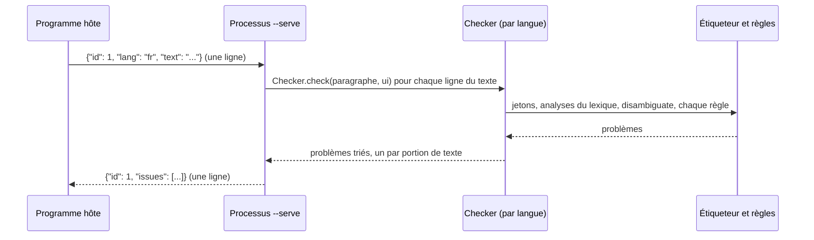

# Référence de l'API du moteur grammatical

*English version: [API.en.md](API.en.md).*

Ce document est la référence de quiconque écrit un client ou un programme hôte. Il liste chaque manière d'appeler le moteur (Python, ligne de commande, mode serveur, passerelle), regroupée par usage, avec ses champs, son rôle, ses cas d'erreur et un exemple réel. Le fonctionnement interne est dans [ARCHITECTURE.md](ARCHITECTURE.md) ; pour écrire une langue, voir [WRITING_A_LANGUAGE.md](WRITING_A_LANGUAGE.md) ; les règles sont listées dans [RULES.md](RULES.md) ; le format du lexique est dans [LEXICON.md](LEXICON.md) ; des programmes complets en six langages sont dans [../examples/](../examples/README.md). Ces fichiers sont en anglais.

Contenu : vérifier un texte, le résultat, langues et variantes, règles, le dictionnaire orthographique de l'hôte, écrire une langue, la passerelle pour les programmes qui embarquent Python, versions et limites. Chaque exemple ci-dessous a été produit en lançant le moteur (`tools/build_api_docs.py` écrit ce fichier à partir d'un modèle et exécute chaque exemple) ; version du moteur 0.2.0. Les messages des exemples sont ceux du moteur, dans la langue demandée.

## 0. Conventions

### Les phrases d'exemple

Tous les exemples utilisent les mêmes phrases, pour comparer les résultats d'une section à l'autre.

| Nom | Langue | Texte | Ce qui est faux |
|---|---|---|---|
| `FR` | `fr` | `Les chat dorment sur le canapé.` | « chat » après « les » : le pluriel est « chats » |
| `EN` | `en` | `These book is very old.` | « book » après « these » : le pluriel est « books » |
| `ES` | `es` | `Los casa son bonitas.` | « casa » après « los » : le pluriel est « casas » |
| `TWO_LINES` | `fr` | `Il mange.` et `Les chat dorment.` (deux paragraphes) | le second est `FR` sans sa fin |

### Les quatre couches

| Couche | Ce que c'est | Usage |
|---|---|---|
| API Python | le paquet `grammar_engine` : `Checker`, `Issue`, `Grammar`, `Paragraph`, `Token` | `import grammar_engine` (section 1) |
| Ligne de commande | `python -m grammar_engine` | texte sur l'entrée standard ou dans des fichiers, JSON sur la sortie standard (section 1) |
| Mode serveur | `python -m grammar_engine --serve` | une requête JSON par ligne en entrée, une réponse JSON par ligne en sortie (sections 1 à 5) |
| Passerelle | le module `grammar_engine.bridge` | pour un programme qui embarque Python et appelle des fonctions avec des textes en arguments (section 8) |

Un hôte écrit en C, C++, C#, Java, JavaScript ou tout autre langage utilise le mode serveur (ou la passerelle, s'il embarque Python). Un programme Python importe le paquet.

### Encodages

- Le texte est de l'Unicode. En mode serveur et en ligne de commande : JSON en UTF-8 sur chaque tube, quelle que soit la page de codes de la machine.
- Les noms de champs sont en `snake_case`. Un champ de requête inutile est omis.
- Positions : `start` et `end` comptent des **points de code** Unicode ; `byte_start` et `byte_end` comptent des **octets UTF-8**. Les deux partent de zéro et la fin est exclue : le problème est `text[start:end]`. Utilisez la paire dans laquelle compte votre composant de texte (section 3).
- Codes de langue : `fr`, `en`, `es` ; une variante avec une région : `es-AR` (ou `es_AR`). Seuls la langue et une variante éventuelle comptent, la casse est sans effet ; `fr-FR` est cherché comme `fr_fr` puis, faute de variante, comme `fr`.
- Identifiants de règles : `<langue>.<nom>` en minuscules, par exemple `fr.det_number` ; les règles de toute langue commencent par `any.`.
- La langue des messages (`ui`) : les deux premières lettres, `en`, `fr`, `es`. Toute autre valeur donne l'anglais.

### Requêtes et réponses (mode serveur)

Une requête est un objet JSON sur une ligne. La réponse est un objet JSON sur une ligne, avec le même `id`. L'`id` est le vôtre (un nombre ou une chaîne ; il peut manquer et revient alors `null`). Les réponses reviennent dans l'ordre des requêtes, une à la fois.

Une réponse n'a jamais à la fois `issues` et `error`. Une requête que le moteur ne sait pas traiter reçoit un texte `error` destiné aux personnes ; le processus reste en vie :

```text
> {"id": 10, "lang": "fr"}
< {"id": 10, "error": "a \"check\" request has \"text\" or \"paragraphs\""}
> {"id": 11, "op": "spell"}
< {"id": 11, "error": "unknown operation \"spell\""}
> {"id": 12, "lang": "fr", "paragraphs": "Il mange."}
< {"id": 12, "error": "\"paragraphs\" is a list of strings"}
> not json
< {"id": null, "error": "invalid request: Expecting value: line 1 column 1 (char 0)"}
> [1, 2]
< {"id": null, "error": "invalid request: a request is a JSON object"}
```

Quand la ligne n'est pas du JSON valide, ou que c'est du JSON qui n'est pas un objet, l'`id` de la réponse est `null`.

### Où s'arrête un paragraphe

Le moteur vérifie **un paragraphe à la fois**. Un saut de ligne à l'intérieur d'un paragraphe n'est pas compris (il est lu comme un signe de ponctuation, si bien que les règles qui regardent le début d'une phrase ou les voisins se trompent). Donnez un texte sous forme de liste de paragraphes (`paragraphs`), ou laissez le moteur couper sur `\n` (`text` en mode serveur et en ligne de commande). Un texte fait seulement d'espaces et de tabulations ne donne aucun problème.

## 1. Démarrer

### Depuis Python

```
import grammar_engine
```

Le dossier `grammar-engine` (celui qui contient `grammar_engine/`) doit être dans `sys.path` : lancez depuis lui, installez-le, ou ajoutez-le avec `sys.path.insert`. Il n'y a rien à installer : la bibliothèque standard suffit.

```python
import grammar_engine

checker = grammar_engine.Checker('fr')
for issue in checker.check('Les chat dorment sur le canapé.', ui='en'):
    print(issue.rule, issue.start, issue.end, issue.suggestions)

# output:
# fr.det_number 4 8 ['chats']
```

`Checker('fr')` construit le vérificateur d'une langue. Le premier d'une langue lit le lexique (quelques dizaines de millisecondes, section 10) ; les suivants le partagent. Gardez le `Checker` et appelez `check()` autant de fois que nécessaire.

### En ligne de commande

`python -m grammar_engine [fichiers] [options]` lit les fichiers (ou l'entrée standard), un paragraphe par ligne, et écrit les problèmes en JSON :

```text
echo "Les chat dorment sur le canapé." | python -m grammar_engine --lang fr --ui en
[
 {
  "rule": "fr.det_number",
  "category": "agreement",
  "start": 4,
  "end": 8,
  "arg": "chats",
  "suggestions": [
   "chats"
  ],
  "confidence": 0.8,
  "message": "The determiner and the noun do not agree in number: \"chats\".",
  "text": "chat",
  "byte_start": 4,
  "byte_end": 8,
  "line": 1
 }
]
```

| Option | Sens |
|---|---|
| `--lang CODE` | langue du texte (`en` par défaut) |
| `--ui CODE` | langue des messages (`en` par défaut) |
| `--ignore ID,ID` | règles à désactiver |
| `--path DOSSIER` | dossier de vos propres langues et lexiques (répétable) |
| `--rules` | liste les règles de la langue et quitte |
| `--lines` | un objet JSON par problème et par ligne, au lieu d'un tableau |
| `--serve` | mode serveur (ci-dessous) |
| `--version` | affiche la version du moteur |

Chaque problème a les champs de la section 3, plus `line` (numéro de la ligne à partir de 1, c'est-à-dire du paragraphe), `text`, `byte_start` et `byte_end`. Les positions sont relatives à la ligne. Avec `--lines` :

```text
python -m grammar_engine --lang fr --lines < two_lines.txt
{"rule": "fr.det_number", "category": "agreement", "start": 4, "end": 8, "arg": "chats", "suggestions": ["chats"], "confidence": 0.8, "message": "The determiner and the noun do not agree in number: \"chats\".", "text": "chat", "byte_start": 4, "byte_end": 8, "line": 2}
```

Code de sortie 0, y compris quand des problèmes sont trouvés. Un fichier illisible, ou qui n'est pas en UTF-8, arrête le programme avec un message d'erreur Python.

### Mode serveur

`python -m grammar_engine --serve` lance un processus qui reste en vie. Il lit une requête par ligne sur l'entrée standard et écrit une réponse par ligne sur la sortie standard, vidée après chaque réponse. Il s'arrête quand son entrée standard est fermée. Un `Checker` est construit la première fois qu'une langue est demandée et conservé : le lexique est lu une fois par processus.

```text
> {"id": 1, "lang": "fr", "ui": "en", "text": "Les chat dorment sur le canapé."}
< {"id": 1, "issues": [{"rule": "fr.det_number", "category": "agreement", "start": 4, "end": 8, "arg": "chats", "suggestions": ["chats"], "confidence": 0.8, "message": "The determiner and the noun do not agree in number: \"chats\".", "text": "chat", "byte_start": 4, "byte_end": 8, "paragraph": 0}]}
```



Un hôte démarre le processus une fois, écrit une requête, lit une ligne, et recommence. Pour l'arrêter, il ferme son entrée. Les programmes de [../examples/](../examples/README.md) montrent cela en six langages.

## 2. Vérifier un texte

### `check` (la requête par défaut)

Couche : mode serveur. Réponse : `issues`, ou `error`.

| Champ | Type | Obligatoire | Sens |
|---|---|---|---|
| `id` | tout | non | renvoyé dans la réponse |
| `op` | chaîne | non | `"check"` (par défaut) |
| `lang` | chaîne | non | langue du texte ; `en` si omis |
| `ui` | chaîne | non | langue des messages ; `en` si omis |
| `text` | chaîne | l'un des deux | un texte ; il est coupé sur `\n`, chaque ligne est un paragraphe |
| `paragraphs` | liste de chaînes | l'un des deux | les paragraphes ; quand les deux champs sont présents, `paragraphs` est utilisé |
| `ignore` | liste de chaînes | non | identifiants de règles à désactiver pour cette requête |

La réponse est `{"id": ..., "issues": [...]}`. Chaque problème a les champs de la section 3, plus `paragraph` (indice du paragraphe, à partir de zéro).

Avec `text`, les positions sont **absolues dans le texte entier** : un saut de ligne compte pour un caractère, et `byte_start` compte aussi les octets des lignes précédentes, de sorte que le problème se repère directement dans le tampon :

```text
> {"id": 2, "lang": "fr", "ui": "en", "text": "Il mange.\nLes chat dorment."}
< {"id": 2, "issues": [{"rule": "fr.det_number", "category": "agreement", "start": 14, "end": 18, "arg": "chats", "suggestions": ["chats"], "confidence": 0.8, "message": "The determiner and the noun do not agree in number: \"chats\".", "text": "chat", "byte_start": 14, "byte_end": 18, "paragraph": 1}]}
```

Ici le second paragraphe commence au point de code 10, donc `chat` est de 14 à 18. Avec `paragraphs`, les positions sont **relatives à chaque paragraphe** :

```text
> {"id": 3, "lang": "fr", "ui": "en", "paragraphs": ["Il mange.", "Les chat dorment."]}
< {"id": 3, "issues": [{"rule": "fr.det_number", "category": "agreement", "start": 4, "end": 8, "arg": "chats", "suggestions": ["chats"], "confidence": 0.8, "message": "The determiner and the noun do not agree in number: \"chats\".", "text": "chat", "byte_start": 4, "byte_end": 8, "paragraph": 1}]}
```

Points de code et octets diffèrent dès qu'il y a une lettre accentuée : `É` et `é` font un point de code et deux octets chacun.

```text
> {"id": 6, "lang": "fr", "text": "Été. Les chat dorment."}
< {"id": 6, "issues": [{"rule": "fr.det_number", "category": "agreement", "start": 9, "end": 13, "arg": "chats", "suggestions": ["chats"], "confidence": 0.8, "message": "The determiner and the noun do not agree in number: \"chats\".", "text": "chat", "byte_start": 11, "byte_end": 15, "paragraph": 0}]}
```

Un texte vide, ou fait d'espaces, donne une liste vide :

```text
> {"id": 13, "lang": "fr", "text": ""}
< {"id": 13, "issues": []}
```

Erreurs : `lang` qui n'est pas une chaîne, `ignore` qui n'est pas une liste, `paragraphs` qui n'est pas une liste de chaînes, ni `text` ni `paragraphs`, une `op` inconnue. Une langue que le moteur ne connaît pas n'est pas une erreur : la grammaire de base est utilisée et seules les règles de toute langue (`any.repeat`, `any.capital`) tournent.

### Python : `Checker.check(text, ui='en')`

Renvoie la liste des `Issue` d'**un paragraphe**, triée par position. Elle ne lève jamais d'exception à cause d'un texte. Les positions sont des points de code dans `text`.

Pour un texte de plusieurs paragraphes, bouclez dessus :

```python
for number, paragraph in enumerate('Il mange.\nLes chat dorment.'.split('\n')):
    for issue in checker.check(paragraph):
        print(number, issue.rule, issue.start, issue.end)

# output:
# 1 fr.det_number 4 8
```

### Ignorer des règles

En Python, `Checker(language, ignored=[...])` ; en ligne de commande `--ignore` ; en mode serveur `ignore` dans chaque requête ; dans la passerelle une chaîne séparée par des virgules. Une règle est sautée quand son identifiant figure dans la liste. Une méthode qui peut signaler plusieurs identifiants (`emits`, section 5) n'est sautée que si tous sont listés ; les problèmes d'un identifiant listé sont de toute façon écartés.

```python
grammar_engine.Checker('fr').check(...)                          # rules: ['fr.det_number']
grammar_engine.Checker('fr', ignored=['fr.det_number']).check(...)    # rules: []
```

```text
> {"id": 4, "lang": "fr", "ui": "fr", "text": "Les chat dorment sur le canapé.", "ignore": ["fr.det_number"]}
< {"id": 4, "issues": []}
```

### La langue des messages

`ui` choisit la table de messages. On cherche d'abord la table de la langue, puis celles des langues dont elle dérive, puis les messages de toute langue ; dans chacune, `ui` puis `en`. Si rien n'est trouvé, le message est l'identifiant de la règle. `{arg}` est remplacé par l'`arg` du problème.

```python
for ui in ('en', 'fr', 'es', 'de'):
    print(ui, grammar_engine.Checker('fr').check('Les chat dorment sur le canapé.', ui=ui)[0].message)

# output:
# en The determiner and the noun do not agree in number: "chats".
# fr Le déterminant et le nom ne s'accordent pas en nombre : « chats ».
# es El determinante y el nombre no concuerdan en número: "chats".
# de The determiner and the noun do not agree in number: "chats".
```

```text
> {"id": 5, "lang": "fr", "ui": "es", "text": "Les chat dorment sur le canapé."}
< {"id": 5, "issues": [{"rule": "fr.det_number", "category": "agreement", "start": 4, "end": 8, "arg": "chats", "suggestions": ["chats"], "confidence": 0.8, "message": "El determinante y el nombre no concuerdan en número: \"chats\".", "text": "chat", "byte_start": 4, "byte_end": 8, "paragraph": 0}]}
```

## 3. Le résultat

### Le problème (`Issue`)

Un problème est un dictionnaire en mode serveur et un objet `Issue` en Python (`Issue.as_dict()` donne le dictionnaire de ses champs) :

```python
issue = checker.check('Les chat dorment sur le canapé.', ui='en')[0]
issue.as_dict()

# result:
{
  "rule": "fr.det_number",
  "category": "agreement",
  "start": 4,
  "end": 8,
  "arg": "chats",
  "suggestions": [
    "chats"
  ],
  "confidence": 0.8,
  "message": "The determiner and the noun do not agree in number: \"chats\"."
}
```

| Champ | Type | Sens |
|---|---|---|
| `rule` | chaîne | identifiant de la règle qui l'a signalé, `<langue>.<nom>` |
| `category` | chaîne | `agreement`, `conjugation`, `spelling`, `syntax`, `punctuation`, `repetition` ou `expression` pour les règles livrées ; une langue à vous peut en utiliser d'autres ; `other` pour un identifiant que la grammaire ne connaît pas |
| `start`, `end` | entier | la plage en points de code, dans le paragraphe (dans le texte entier pour une requête `text`) |
| `byte_start`, `byte_end` | entier | la même plage en octets UTF-8 (mode serveur et ligne de commande ; l'`Issue` Python ne les a pas) |
| `text` | chaîne | le texte de la plage, `text[start:end]` (mode serveur et ligne de commande) |
| `arg` | chaîne | la valeur qui remplace `{arg}` dans le message, le plus souvent le mot corrigé |
| `suggestions` | liste de chaînes | par quoi remplacer la plage ; les règles livrées en donnent exactement une |
| `confidence` | nombre | de 0 à 1 : le degré de certitude de la règle. C'est la confiance par défaut de la règle, ou une valeur plus basse pour un cas douteux. Un hôte peut masquer les problèmes sous un seuil |
| `message` | chaîne | l'explication dans la langue de l'interface |
| `paragraph` | entier | mode serveur seulement : indice du paragraphe |
| `line` | entier | ligne de commande seulement : numéro de ligne, à partir de 1 |

**Une suggestion vide veut dire « supprimer ».** La plage est alors remplacée par rien. La plage d'un mot répété inclut l'espace avant la seconde copie, si bien que la supprimer laisse un espacement correct :

```python
>>> [(i.rule, 'Il y a un un chat.'[i.start:i.end], i.suggestions) for i in grammar_engine.Checker('fr').check('Il y a un un chat.')]
[('any.repeat', ' un', [''])]
```

**Une suggestion remplace la plage telle quelle.** Les règles livrées lui donnent la casse du texte : une majuscule initiale quand la première lettre de la plage est une majuscule. Un hôte applique une suggestion en remplaçant `text[start:end]` et rien d'autre.

**Plages qui se chevauchent : la première gagne.** Les problèmes sont triés par `start` (tri stable : à début égal, dans l'ordre où les règles ont tourné). Un problème qui commence avant la fin de celui retenu juste avant est écarté. Une portion de texte a donc au plus un problème, et un hôte n'a jamais à fusionner deux corrections des mêmes mots. L'ordre des règles est l'ordre alphabétique des noms des méthodes de la grammaire.

### Choisir les bonnes positions

| Votre texte est... | Utilisez | Pourquoi |
|---|---|---|
| un `str` Python, une ligne d'un `Text` Tk | `start`, `end` | Python compte des points de code |
| une chaîne UTF-16 (C#, Java, JavaScript, Swing, WinForms) | `start`, `end`, convertis | un caractère hors du plan multilingue de base (un émoji, certains idéogrammes rares) fait deux unités UTF-16 : parcourez la chaîne et ajoutez 2 pour une unité haute |
| un tampon UTF-8 (C, C++, Dear ImGui, Go, Rust) | `byte_start`, `byte_end` | aucune conversion |
| la réponse de la passerelle | `start`, `end` | la passerelle écrit des octets dans ces deux champs (section 8) |

## 4. Langues et variantes

### `languages`

Couche : mode serveur. Réponse : `languages`.

| Champ | Type | Obligatoire | Sens |
|---|---|---|---|
| `id` | tout | non | renvoyé |
| `op` | chaîne | oui | `"languages"` |

La réponse liste les fichiers de grammaire du moteur et des dossiers donnés avec `--path` :

```text
> {"id": 8, "op": "languages"}
< {"id": 8, "languages": [{"code": "en", "variant_of": null, "lexicon": true, "rules": 15}, {"code": "es", "variant_of": null, "lexicon": true, "rules": 16}, {"code": "es-AR", "variant_of": "es", "lexicon": true, "rules": 17}, {"code": "fr", "variant_of": null, "lexicon": true, "rules": 28}]}
```

| Champ | Sens |
|---|---|
| `code` | le code à passer comme `lang` |
| `variant_of` | la langue dont une variante dérive, ou `null` |
| `lexicon` | `true` quand la langue a un lexique (sans lui, seules les règles qui n'en ont pas besoin fonctionnent) |
| `rules` | le nombre de règles de la langue, héritées comprises |

### Comment un code est résolu

`Checker('es-AR')` normalise le code en `es_ar` et cherche un fichier de grammaire `es_ar.py` (d'abord dans les dossiers de `paths`, puis dans `langs/`) ; s'il n'y en a pas, les deux premières lettres donnent `es.py` ; s'il n'y en a pas non plus, la grammaire de base est utilisée.

```python
grammar_engine.Checker('es-MX').grammar.language     # no file langs/es_mx.py: the Spanish grammar is used
# 'es'
grammar_engine.Checker('zz').grammar.language        # no file at all: the base grammar
# 'any'
```

### Variantes

Une variante dérive de sa langue et n'ajoute ou ne remplace que ce qui diffère ; `es_ar.py` commence par `from . import es` et `class Grammar(es.Grammar)`. Ses règles, ses messages et son lexique sont ceux du parent plus les siens.

```python
grammar_engine.Checker('es-AR').check('Vos tienes razón.')[0].suggestions
# ['Vos tenés']
grammar_engine.Checker('es').check('Vos tienes razón.')
# []
```

### Vos propres langues : `paths`

`Checker(language, paths=[dossier, ...])`, `--path DOSSIER`, ou `bridge.configure('["dossier"]')`. Un fichier `<code>.py` dans un dossier remplace la langue livrée de même code ; un fichier de lexique (`fr.lex`...) dans un dossier remplace celui qui est livré. Un hôte les garde en général dans son dossier de données utilisateur, par exemple `%AppData%\MonApp\grammar`. Un dossier de `paths` qui n'existe pas est ignoré.

```python
from grammar_engine import core
from grammar_engine.core import rule


class Grammar(core.Grammar):
    language = 'xx'
    messages = {'en': {'xx.shout': 'No capital words: "{arg}".'}}

    @rule('xx.shout', 'style', 0.6)
    def shout(self, p):
        """a word in capitals: STOP -> stop"""
        for tok in p.tokens:
            if tok.kind == 'word' and len(tok.text) > 2 and tok.text.isupper():
                p.add('xx.shout', tok, tok, tok.text.lower(), tok.text)
```

```python
checker = grammar_engine.Checker('xx', paths=[r'C:\Users\me\grammar'])
[(i.rule, i.start, i.end, i.suggestions, i.message) for i in checker.check('Please STOP now.')]
# [('xx.shout', 7, 11, ['stop'], 'No capital words: "STOP".')]
```

Les identifiants de vos règles commencent par le code de votre langue (`xx.`) ; la catégorie est la vôtre.

## 5. Règles

### `rules`

Couche : mode serveur. Réponse : `rules`.

| Champ | Type | Obligatoire | Sens |
|---|---|---|---|
| `id` | tout | non | renvoyé |
| `op` | chaîne | oui | `"rules"` |
| `lang` | chaîne | non | langue ; `en` si omis |

```text
> {"id": 7, "op": "rules", "lang": "es-AR"}
< {"id": 7, "rules": [{"id": "es.accent", "category": "spelling", "confidence": 0.85, "language": "es"}, {"id": "any.capital", "category": "punctuation", "confidence": 0.7, "language": "any"}, ...]}   (17 rules in all)
```

Chaque règle a `id`, `category`, `confidence` (celle par défaut) et `language` (la partie de l'identifiant avant le point). La liste de toutes les règles est dans [RULES.md](RULES.md). En Python, c'est `Checker.rules()` ; en ligne de commande `--rules`.

### Catégories

| Catégorie | Ce que regardent ses règles |
|---|---|
| `agreement` | genre, nombre, personne entre les mots |
| `conjugation` | temps, modes, participes, infinitifs |
| `spelling` | mots mal orthographiés en contexte : homophones, accents, élisions |
| `syntax` | prépositions, constructions |
| `punctuation` | majuscules, signes inversés |
| `repetition` | mots répétés |
| `expression` | locutions figées et erreurs figées |

Un hôte peut utiliser la catégorie pour colorer les problèmes ou laisser l'utilisateur en désactiver un genre.

### Désactiver une règle

Mettez son `id` dans `ignore` (section 2). Un utilisateur en désaccord avec une règle peut désactiver celle-là seule : un hôte peut proposer ainsi « ignorer cette règle ».

### Deux identifiants pour une règle

Quelques méthodes signalent plus d'un identifiant (`fr.det_number` et `fr.det_gender` viennent de la même méthode). Elles sont listées ensemble dans [RULES.md](RULES.md). Désactiver la méthode, c'est lister tous les identifiants qu'elle émet.

## 6. Le dictionnaire orthographique de l'hôte

Certaines corrections ne sont sûres que si l'hôte peut dire si un mot existe. Un hôte peut avoir un dictionnaire orthographique (Hunspell, par exemple). Un `Checker` prend `known=fonction(mot) -> bool` ; les règles qui en ont besoin se taisent sans lui.

| Règle | A besoin de `known` pour |
|---|---|
| `fr.participle` | après un auxiliaire, un verbe en -er : `il a manger` est corrigé en `mangé` seulement si `mangé` et `manger` sont des mots |
| `fr.infinitive` | après `pour`, `sans` ou un verbe modal, un participe en -é : l'infinitif doit être un mot |

```python
words = {'mangé', 'manger'}
grammar_engine.Checker('fr').check('Il a manger.')                              # []
grammar_engine.Checker('fr', known=lambda w: w in words).check('Il a manger.')   # [('fr.participle', ['mangé'])]
```

`known` est appelé avec un mot à la fois, dans la casse du texte pour la forme d'origine et en minuscules pour la correction. Elle ne doit pas lever d'exception ; elle doit être rapide (elle est appelée quelques fois par paragraphe). La ligne de commande et le mode serveur n'ont pas de dictionnaire, donc ces deux règles n'y tournent pas ; la passerelle en a un (section 8).

## 7. Écrire une langue

Le tutoriel est [WRITING_A_LANGUAGE.md](WRITING_A_LANGUAGE.md). Cette section liste ce qu'une règle peut appeler. Une langue est un fichier `<code>.py` avec une classe nommée `Grammar` qui dérive de `grammar_engine.core.Grammar`.

### `Grammar` (la classe d'une langue)

| Membre | Sens |
|---|---|
| `language` | le code de la langue, `'fr'` ; pour une variante, `'es_ar'` |
| `elisions` | tuple des formes élidées que le découpeur sépare : `("l'", "qu'")` ; le mot qui suit est un jeton à part |
| `lexicon` | nom du fichier de lexique, `'fr.lex'`, ou `None` |
| `messages` | `{ui: {id de règle: texte}}`, `{arg}` est remplacé |
| `removed_rules` | identifiants de règles héritées qu'une variante ne veut pas |
| `Grammar.disambiguate(p)` | appelée une fois par paragraphe, une fois les analyses du lexique posées sur les mots et avant les règles ; c'est la place des contraintes de l'étiqueteur. Ne fait rien par défaut |
| `Grammar.phrases(p, table, rule_id)` | signale les locutions fixes de `table`, une liste de `(words, replacement, not_before_capital)` : `words` est une chaîne de mots séparés par une espace, comparée en minuscules ; le remplacement prend la casse de la première lettre du texte |
| `Grammar.rules()` | la liste des dictionnaires de règles |
| `Grammar.message(ui, rule_id)` | le texte du message |
| `Grammar.check(p, ignored)` | appelle chaque règle ; ne pas redéfinir |
| `rule(rule_id, category, confidence, emits)` | le décorateur qui marque une méthode comme règle. `emits` liste les autres identifiants que la méthode peut signaler |

Une règle est une méthode `nom(self, p)` marquée `@rule`. Elle est appelée une fois par paragraphe avec un `Paragraph` ; elle signale avec `p.add(...)`. Elle ne doit pas modifier les jetons ; elle ne doit pas lever d'exception.

### `Paragraph` (ce sur quoi travaille une règle)

| Membre | Sens |
|---|---|
| `p.text` | le texte du paragraphe |
| `p.tokens` | la liste des jetons ; `p[i]` est `p.tokens[i]` et `len(p)` le nombre de jetons |
| `p.issues` | les problèmes signalés jusque-là |
| `Paragraph.word(i)` | vrai quand le jeton `i` existe et est un mot (faux pour un `i` négatif ou au-delà de la fin) |
| `Paragraph.add(rule_id, first, last, suggestion, arg='', confidence=None)` | signale un problème sur les jetons `first` à `last` (inclus, ce sont des objets `Token`) ; `suggestion` les remplace, `arg` remplit `{arg}` ; `confidence` remplace la valeur par défaut |
| `Paragraph.add_range(rule_id, start, end, suggestion, arg='', confidence=None)` | la même chose sur une plage de points de code, pour un problème qui ne couvre pas des jetons entiers (une espace, une partie de mot) |

### `Token`

| Champ | Sens |
|---|---|
| `kind` | `'word'`, `'number'` ou `'punct'` |
| `text` | tel qu'écrit |
| `low` | en minuscules, avec l'apostrophe droite |
| `start`, `end` | points de code dans le paragraphe |
| `space_before` | vrai quand une espace (ou le début du paragraphe) précède |
| `tags` | les lectures laissées par l'étiqueteur : un tuple de `lexicon.Analysis` (vide pour une langue sans lexique) |
| `is_word` | vrai pour un mot |

Le découpeur (`text.tokenize(text, elisions=())`) garde une apostrophe ou un trait d'union dans un mot quand une lettre suit (`aujourd'hui`, `peut-être`, `don't`), sépare une élision de la langue en un jeton à part, lit `...` comme un seul `…`, et met tout autre caractère dans un jeton à lui.

### L'étiqueteur

`grammar_engine.tagger` donne à chaque mot toutes les analyses du lexique, puis la langue retire les lectures que le contexte exclut (`Grammar.disambiguate`). Une contrainte ne vide jamais un mot.

| Fonction | Sens |
|---|---|
| `tagger.assign(p, lex)` | met toutes les analyses du lexique sur chaque mot ; un mot inconnu reçoit une lecture (un nom propre dans une phrase, sinon autre). Appelée par le vérificateur |
| `tagger.keep(t, mask)` | garde les lectures de la catégorie `mask` ; ne fait rien s'il n'en resterait aucune ; renvoie si elle a agi |
| `tagger.drop(t, mask)` | retire les lectures de `mask` ; même garde-fou |
| `tagger.select(t, predicate)` | garde les lectures pour lesquelles `predicate(analysis)` est vrai ; même garde-fou |
| `tagger.only(t, mask)` | vrai quand toutes les lectures sont de `mask` |
| `tagger.has(t, mask)` | vrai quand une lecture est de `mask` |
| `tagger.pos(t)` | la catégorie quand les lectures s'accordent sur une, sinon 0 |

`mask` est une combinaison comme `lexicon.NOUN | lexicon.ADJ` (les catégories sont des bits : `NOUN, ADJ, VERB, AUX, DET, PRON, ADP, ADV, CCONJ, SCONJ, PROPN, INTJ, OTHER`).

### Le lexique

`Checker.lexicon` est un `lexicon.Lexicon` ou `None`. Une règle l'obtient par `self.core.lexicon`.

| Membre | Sens |
|---|---|
| `Lexicon.analyses(word)` | toutes les analyses d'un mot tel qu'écrit, sinon en minuscules ; un tuple, vide si inconnu. Chacune est une `Analysis(lemma, pos, gender, number, person, verb_form, index)` |
| `Lexicon.lemma(a)` | le lemme d'une analyse, en chaîne |
| `Lexicon.inflect(model, gender=0, number=0, person=0, verb_form=0)` | la forme du même lemme et de la même catégorie avec d'autres traits (0 = indifférent) ; `''` s'il n'y en a pas. C'est ainsi que les règles trouvent la forme corrigée |
| `Lexicon.load(path)` | lit un fichier de lexique |
| `Lexicon.loaded` | vrai quand un lexique est chargé |

Valeurs : genre `0` aucun, `1` masculin, `2` féminin, `3` épicène ; nombre `0` aucun, `1` singulier, `2` pluriel, `3` invariable ; personne `0` à `3` ; forme verbale `PRESENT, IMPERFECT, PAST_SIMPLE, FUTURE, CONDITIONAL, SUBJUNCTIVE_PRESENT, SUBJUNCTIVE_IMPERFECT, IMPERATIVE, INFINITIVE, PRESENT_PARTICIPLE, PAST_PARTICIPLE` (de 1 à 11).

### `Checker` (ce que l'hôte appelle)

| Membre | Sens |
|---|---|
| `Checker(language='en', known=None, ignored=(), paths=())` | construit le vérificateur |
| `Checker.check(text, ui='en')` | les problèmes d'un paragraphe |
| `Checker.rules()` | les règles de la langue |
| `Checker.set_language(language)` | change de langue ; le lexique est partagé |
| `.language`, `.grammar`, `.lexicon`, `.known`, `.ignored`, `.paths` | le code normalisé, la `Grammar`, le `Lexicon` ou `None`, la fonction de rappel, l'ensemble des identifiants ignorés, les dossiers absolus |

`text.match_case(original, replacement)` donne au remplacement une majuscule initiale quand l'original en a une. Une règle qui construit sa propre suggestion s'en sert.

## 8. La passerelle

`grammar_engine.bridge` est pour un programme qui embarque Python (par l'interface stable de Python 3.12, par exemple) : chaque argument et chaque résultat est une chaîne, si bien que l'hôte n'a besoin de rien connaître des objets du moteur.

| Fonction | Sens |
|---|---|
| `bridge.configure(paths_json)` | dossiers de vos propres langues, en liste JSON de chaînes : `'["C:/Users/moi/grammar"]'`. Oublie les vérificateurs déjà construits |
| `bridge.set_known(fn)` | le dictionnaire orthographique de l'hôte, `fn(word) -> bool` (un appelable Python ; un hôte C en fabrique un avec `PyCFunction_New`). Oublie les vérificateurs déjà construits |
| `bridge.check(language, ui, ignored, text)` | les problèmes d'un paragraphe, en texte JSON. `ignored` est une chaîne séparée par des virgules (`'fr.a,fr.ont'`, ou `''`) ; `ui` est coupé à deux lettres |
| `bridge.rules(language)` | les règles d'une langue, en texte JSON |

```python
from grammar_engine import bridge

bridge.check('fr', 'en', '', 'Été. Les chat dorment.')
# [{"rule": "fr.det_number", "category": "agreement", "start": 11, "end": 15, "arg": "chats", "suggestions": ["chats"], "confidence": 0.8, "message": "The determiner and the noun do not agree in number: \"chats\"."}]
```

Les problèmes de la passerelle ont les champs de l'`Issue` Python, et **`start` et `end` sont en octets UTF-8** (ce que indexe un hôte C ou C++), pas en points de code. Ils n'ont ni `text`, ni `byte_start`, ni `byte_end`.

```python
json.loads(bridge.rules('es-AR'))[:2]
# [{"id": "es.accent", "category": "spelling", "confidence": 0.85, "language": "es"}, {"id": "any.capital", "category": "punctuation", "confidence": 0.7, "language": "any"}]
# ... 17 rules in all
```

```python
bridge.set_known(lambda w: w in {'mangé', 'manger'})
bridge.check('fr', 'en', '', 'Il a manger.')
# [{"rule": "fr.participle", "category": "conjugation", "start": 5, "end": 11, "arg": "mangé", "suggestions": ["mangé"], "confidence": 0.8, "message": "After an auxiliary (avoir or être) the verb is a past participle: \"mangé\"."}]
```

Comment un hôte s'en sert, typiquement : à la première utilisation il trouve le dossier `grammar-engine` à côté de l'exécutable (ou un ou deux niveaux plus haut), le met dans `sys.path`, importe `grammar_engine.bridge`, appelle `configure` avec le dossier de ses propres langues et `set_known` avec une fonction adossée à son dictionnaire Hunspell, puis appelle `check` pour chaque paragraphe avec la langue du projet, la langue de l'interface et les identifiants des règles que l'utilisateur a désactivées. Si Python ou le moteur manque, l'hôte peut se rabattre sur un vérificateur à lui.

La passerelle garde jusqu'à 16 vérificateurs (un par langue et ensemble de règles ignorées) ; au-delà elle les oublie tous et en reconstruit au besoin.

## 9. Versions et compatibilité

`grammar_engine.__version__` est la version du moteur (`ping` la donne en mode serveur, `--version` en ligne de commande) : `0.2.0`.

```text
> {"id": 9, "op": "ping"}
< {"id": 9, "engine": "grammar_engine", "version": "0.2.0"}
```

Ce qui est stable : les noms des champs de requête, les champs d'un problème, le sens des positions, les identifiants des règles listées dans [RULES.md](RULES.md), les méthodes des sections 1 à 8. Ce qui peut changer d'une version à l'autre : la liste des règles et leur confiance par défaut, le texte des messages, les corrections exactes, l'ordre de deux problèmes de même début. Un hôte doit traiter les champs inconnus d'une réponse comme des suppléments et les identifiants de règles inconnus comme normaux. Le format du lexique a son propre numéro de version (`BNLX`, version 1 ; voir [LEXICON.md](LEXICON.md)).

## 10. Limites

- **Un paragraphe.** Aucune limite de longueur, mais le coût croît avec elle (les règles regardent les voisins de chaque jeton). Coupez un texte à ses sauts de ligne. Une très longue ligne (des centaines de kilo-octets) rend la vérification lente.
- **Taille d'une requête en mode serveur.** Une requête est une ligne ; le moteur n'a pas de limite, c'est l'hôte qui choisit (le serveur d'exemple du dossier JavaScript refuse plus de 2 Mo).
- **Fils d'exécution.** Le moteur n'est pas sûr vis-à-vis des fils : utilisez un processus, ou un `Checker` par fil. Un hôte qui appelle depuis plusieurs fils doit sérialiser ses requêtes (les exemples le font).
- **Temps de chargement et mémoire.** Mesurés sur la machine où cette référence a été écrite (Windows, Python 3.12) ; les chiffres dépendent de la machine. « Chargement » est le premier `Checker(code)` d'un processus (il lit le fichier de lexique) ; « premier appel » est le premier appel de `check` ; « par paragraphe » est la moyenne de 50 vérifications d'une phrase d'environ 90 caractères ; « mémoire max » est le pic de mémoire de travail d'un processus qui a chargé une langue.

<!-- measures:begin -->
| Langue | Chargement | Premier appel | Par paragraphe | Mémoire max |
|---|---|---|---|---|
| `fr` | 21 ms|0.2 ms|2.1 ms|66 MB |
| `en` | 17 ms|0.2 ms|5.3 ms|162 MB |
| `es` | 15 ms|0.1 ms|2.5 ms|90 MB |
<!-- measures:end -->

- **Taille des lexiques.** `fr.lex` 14 Mo, `es.lex` 22 Mo, `en.lex` 28 Mo sur le disque ; le processus garde le fichier en mémoire.
- **Variantes.** `es-AR` partage le lexique espagnol : demander les deux ne coûte rien de plus.
- **Erreurs dans une règle.** Une règle qui lève une exception arrête la vérification de son paragraphe par une exception Python. En mode serveur l'exception devient une réponse `error` et le processus continue.

## Où est quoi

| Je veux... | Aller à |
|---|---|
| vérifier un texte depuis Python | section 1, `Checker.check` |
| vérifier un fichier depuis un script | section 1, ligne de commande |
| utiliser le moteur depuis C#, Java, JavaScript, C++ | section 1 (mode serveur), et [../examples/](../examples/README.md) |
| convertir un résultat en position dans mon composant de texte | section 3, « Choisir les bonnes positions » |
| savoir quelles langues existent | section 4, `languages` |
| lister ou désactiver des règles | section 5 et [RULES.md](RULES.md) |
| donner au moteur mon dictionnaire orthographique | section 6 |
| ajouter une langue ou une variante | section 7 et [WRITING_A_LANGUAGE.md](WRITING_A_LANGUAGE.md) |
| appeler le moteur depuis un programme qui embarque Python | section 8 |
| comprendre comment un paragraphe devient des problèmes | [ARCHITECTURE.md](ARCHITECTURE.md) |
| connaître le format du lexique | [LEXICON.md](LEXICON.md) |
