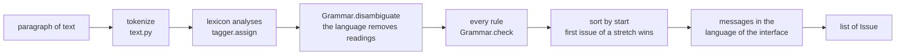
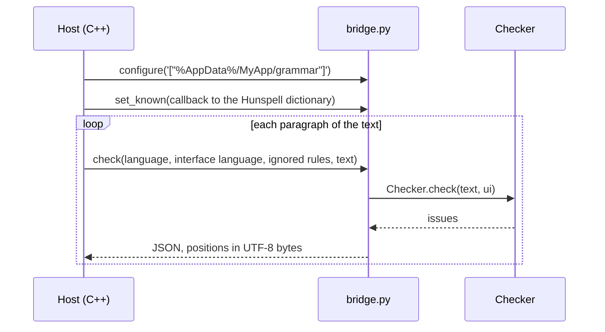

# Architecture

How a paragraph becomes a list of issues. The calls are listed in [API.en.md](API.en.md); how to add a language is in [WRITING_A_LANGUAGE.md](WRITING_A_LANGUAGE.md).

## The flow

1. **Text to tokens** (`text.tokenize`). The paragraph is cut into `Token`s of three kinds: words, numbers, punctuation. An apostrophe or a hyphen followed by a letter stays inside the word (`aujourd'hui`, `peut-être`), except for the elisions of the language (`l'`, `qu'`), which become a token of their own. Each token knows its range in code points and whether a space came before it.
2. **Lexicon** (`tagger.assign`, only if the language has a lexicon). Every word receives all the analyses of the lexicon (lemma, part of speech, gender, number, person, verb form). A word the lexicon does not know gets one reading: a proper name when it has a capital letter inside a sentence, else "other".
3. **Disambiguation** (`Grammar.disambiguate`). The language removes the readings that the neighbours exclude: after a determiner a word is a noun or an adjective, after a subject pronoun it is a conjugated verb, after an auxiliary a participle. The tools are `tagger.keep`, `drop` and `select`; none of them ever empties a word. After this step `token.tags` holds what is left.
4. **Rules** (`Grammar.check`). Each method marked `@rule` runs on the `Paragraph` and reports with `p.add()`. A rule reads tokens and tags, never the raw text; it knows nothing of the other rules.
5. **Result** (`Checker.check`). The issues are sorted by `start` (stable), an issue which starts inside the previous one is dropped, the rules switched off are removed, and each message is built from the table of the language of the interface.

## The pieces

| File | Role |
|---|---|
| `grammar_engine/core.py` | `rule` (decorator), `Issue`, `Paragraph`, `Grammar` (base class: rule collection, messages, the rules of any language, `phrases`), `Checker` (language loading, the flow above) |
| `grammar_engine/text.py` | `Token`, `tokenize`, `match_case`, `lower` |
| `grammar_engine/lexicon.py` | the lexicon reader: binary search of a form, analyses, `inflect` |
| `grammar_engine/tagger.py` | `assign` and the tools of the constraints (`keep`, `drop`, `select`, `only`, `has`, `pos`) |
| `grammar_engine/langs/<code>.py` | one language: a `Grammar` class with its rules, messages and constraints |
| `grammar_engine/langs/es_ar.py` | a variant: derives from `es.Grammar`, adds its rules |
| `grammar_engine/bridge.py` | text-in, text-out functions for a host which embeds Python |
| `grammar_engine/__main__.py` | the command line and the `--serve` loop |
| `grammar_engine/data/*.lex` | the lexicons (format in [LEXICON.md](LEXICON.md)) |
| `tools/build_lexicon*.py` | build a lexicon from its source |
| `tools/show_tags.py` | prints the readings the tagger leaves on a text |
| `tools/list_rules.py` | writes the catalogue [RULES.md](RULES.md) |
| `tools/build_api_docs.py` | writes the API reference by running every example |
| `tests/` | the unit tests |

## Design choices

- **Zero false alarms before more detections.** A rule reports only when its context is unambiguous; when a word can be a noun or a verb, the rule stays silent unless the neighbours decide. The tests of every rule have cases which are reported and cases which are correct.
- **One file per language.** A language does not share rules with another, but the base class holds the few rules that every language has (`any.repeat`, `any.capital`) and the helpers (`phrases`).
- **Inheritance for variants.** A regional variant derives from its language: it gets the rules, the messages and the lexicon for free and lists only what differs (`removed_rules` drops an inherited rule).
- **The lexicon is data, not code.** The rules ask the lexicon for the corrected form (`inflect`), so a rule never contains a table of conjugations.
- **No state between paragraphs.** `Checker.check` has no memory of the previous call; a host may call it in any order. The only caches are the loaded lexicons (shared in the process) and a small LRU of analyses.
- **Same engine for every host.** Python imports it; any other language starts `python -m grammar_engine --serve`; a program that embeds Python calls the bridge. The three share the code and differ only in how text goes in and out.

## How a host embeds it

A C++ host can embed Python through its stable interface (3.12) and call `grammar_engine.bridge`:

The host copies the folder `grammar-engine` beside its executable. If Python or the engine is not there, it can fall back on a checker of its own.
